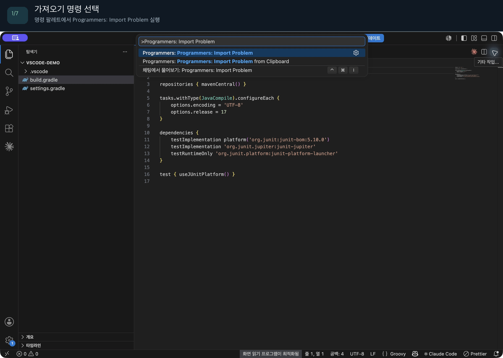

# Programmers Local Runner

[GitHub](https://github.com/ghghtygh/programmers-importer)

프로그래머스 문제 URL에서 Java 기본 코드와 공개 입출력 예제를 가져와 `Solution.java`, JUnit 5 매개변수화 테스트를 로컬에 자동 생성합니다. 풀이는 `Solution.java`에만 작성하면 되고, 테스트 코드를 직접 작성할 필요가 없습니다.

```text
문제 URL 복사 → Import 실행 → Solution.java 구현 → ./gradlew test
```

CLI(`programmers-cli`)와 이를 감싼 VSCode 확장(`programmers-vscode`)을 함께 제공합니다. 어느 쪽을 쓰든 분석·생성 로직은 `programmers-core` 하나를 공유합니다.

## VSCode 시연

실제 VSCode 확장 개발 호스트에서 [12909. 올바른 괄호](https://school.programmers.co.kr/learn/courses/30/lessons/12909)를 가져와 풀이와 테스트를 생성하고, 풀이 구현 후 공개 예제 4개를 통과하는 과정입니다.



`Import Problem` 실행 → URL 입력 → `Solution.java` 자동 열기 → JUnit 테스트 확인 → 클립보드로 중복 문제 가져오기 → 풀이 구현 → Gradle 테스트 성공

GIF는 실제 실행 화면의 주요 단계를 이어 붙이고 한국어 자막을 추가한 것입니다. 검증 환경과 결과는 [VSCode 시연 검증 기록](docs/vscode-demo.md)을 참고하세요.

## 설치

### 요구 사항

- JDK 17 이상 (JDK 21에서 빌드·검증)
- 인터넷 연결 (최초 Gradle 빌드, 문제 페이지 조회 시)
- Gradle은 저장소에 포함된 Wrapper(`./gradlew`)를 사용하므로 별도 설치가 필요 없습니다.

### 1) CLI 빌드

저장소를 클론한 뒤 루트에서 실행합니다.

```bash
./gradlew test :programmers-cli:installDist
export PATH="$PWD/programmers-cli/build/install/programmers/bin:$PATH"
```

Windows에서는 `gradlew.bat`와 설치 디렉터리의 `programmers.bat`를 사용합니다(별도 검증은 하지 않았습니다).

`programmers --version`이 출력되면 설치가 끝난 것입니다.

### 2) VSCode 확장 (선택)

CLI를 Command Palette에서 실행할 수 있게 해주는 얇은 래퍼입니다. 아직 Marketplace에 배포하지 않았으므로 소스에서 직접 실행합니다.

```bash
cd programmers-vscode
npm install
npm run compile
```

VSCode에서 `programmers-vscode` 폴더를 열고 `F5`(Run Extension)를 누르면 Extension Development Host 창이 뜹니다. 그 창에서 열려 있는 **워크스페이스**가 Solution.java/SolutionTest.java가 생성될 위치입니다. 자세한 설정은 [programmers-vscode/README.md](programmers-vscode/README.md)를 참고하세요.

## 사용 가이드

### CLI

```bash
programmers import \
  'https://school.programmers.co.kr/learn/courses/30/lessons/12909' \
  --output examples/java-workspace
```

생성되는 파일:

```text
examples/java-workspace/
├── src/main/java/programmers/p12909/Solution.java
└── src/test/java/programmers/p12909/SolutionTest.java
```

`Solution.java`에 풀이를 작성하고 실행합니다.

```bash
./gradlew -p examples/java-workspace test
```

생성 직후에는 기본 구현이 정답이 아니므로 일부 테스트가 실패하는 것이 정상입니다. **생성된 테스트 코드(`SolutionTest.java`)는 수정할 필요가 없습니다.**

기존 Gradle Java 프로젝트에 적용하려면 `--output /path/to/project`처럼 Java 소스가 들어갈 **모듈 디렉터리**를 지정하세요.

```text
programmers import <URL> [--output <경로>] [--force] [--debug]
programmers --help
programmers --version
```

| 옵션 | 동작 |
| --- | --- |
| `--output` | 생성 기준 경로. 기본값은 현재 디렉터리 |
| `--force` | 해당 문제의 두 생성 파일을 덮어쓰기 |
| `--debug` | 조회·시그니처 분석·예제 분석·생성 로그 및 오류 상세 출력 |

URL은 HTTPS의 `school.programmers.co.kr/learn/courses/{courseId}/lessons/{problemId}` 형식만 지원합니다(다른 언어 쿼리나 fragment가 붙어도 검증 후 Java 페이지를 요청합니다).

둘 중 하나라도 기존 파일이 있으면 기본적으로 실패하며 다른 파일도 생성하지 않습니다. `--force`는 작성한 풀이까지 교체하므로 재생성이 필요할 때만 사용하세요. 생성 파일 준비 중 실패하면 기존 파일을 유지하고, 교체 중 입출력 오류가 발생하면 이미 변경한 파일의 복구를 시도합니다. 프로세스 강제 종료나 다른 프로세스의 동시 수정까지 보장하는 트랜잭션은 아닙니다.

종료 코드는 성공 `0`, Import 실패 `1`, 명령 사용 오류 `2`입니다.

### VSCode 확장

Command Palette(`Cmd+Shift+P` / `Ctrl+Shift+P`)에서 실행합니다.

- **Programmers: Import Problem** — URL을 입력받아 Import
- **Programmers: Import Problem from Clipboard** — 클립보드에 복사된 문제 URL을 바로 Import

내부적으로 위 CLI를 그대로 호출합니다. 워크스페이스에서 `programmers` 실행 파일을 찾지 못하면 `./gradlew :programmers-cli:installDist` 빌드를 제안합니다. Import가 성공하면 `Solution.java`가 자동으로 열리고, 이미 생성된 문제라면 `Open` / `Overwrite` / `Cancel`을 선택할 수 있습니다. 설정(`programmers.cliPath`, `programmers.outputPath`, `programmers.openSolutionAfterImport`)은 [programmers-vscode/README.md](programmers-vscode/README.md)에 정리되어 있습니다.

## 예시

아래는 실제 문제를 Import했을 때 생성되는 파일 그대로입니다(수동으로 손대지 않았습니다).

### [12909. 올바른 괄호](https://school.programmers.co.kr/learn/courses/30/lessons/12909) — `String → boolean`

```bash
programmers import 'https://school.programmers.co.kr/learn/courses/30/lessons/12909' --output examples/java-workspace
```

`src/main/java/programmers/p12909/Solution.java` — 프로그래머스가 제공하는 Java 기본 코드(주석 포함)를 그대로 유지하고 패키지만 추가합니다. 사용자는 `// 구현` 부분만 채우면 됩니다.

```java
package programmers.p12909;

public class Solution {

    boolean solution(String s) {
        boolean answer = true;
        // [실행] 버튼을 누르면 출력 값을 볼 수 있습니다.
        System.out.println("Hello Java");
        return answer;
    }
}
```

`src/test/java/programmers/p12909/SolutionTest.java` — 문제 페이지의 입출력 예 4건이 그대로 `@ParameterizedTest`가 됩니다. `boolean` 반환이므로 `assertEquals`를 사용합니다.

```java
package programmers.p12909;

import org.junit.jupiter.params.ParameterizedTest;
import org.junit.jupiter.params.provider.Arguments;
import org.junit.jupiter.params.provider.MethodSource;
import java.util.stream.Stream;

import static org.junit.jupiter.api.Assertions.assertEquals;

class SolutionTest {

    @ParameterizedTest(name = "공개 예제 {index}")
    @MethodSource("examples")
    void matchesExample(String s, boolean expected) throws Exception {
        assertEquals(expected, new Solution().solution(s));
    }

    static Stream<Arguments> examples() {
        return Stream.of(
            Arguments.of(new Object[]{"()()", true}),
            Arguments.of(new Object[]{"(())()", true}),
            Arguments.of(new Object[]{")()(", false}),
            Arguments.of(new Object[]{"(()(", false})
        );
    }
}
```

### [468381. 기차 선로](https://school.programmers.co.kr/learn/courses/30/lessons/468381) — `int[][] → int`

매개변수가 2차원 배열인 문제는 "동작 원리"에서 설명한 Value AST를 거쳐 중첩 배열 리터럴로 렌더링됩니다.

```java
public int solution(int[][] grid) {
    int answer = 0;
    return answer;
}
```

생성된 테스트의 `examples()`는 문제 페이지 표의 `[[1,0,-1],[0,0,7],[0,0,2]]`가 그대로 `new int[][]{...}`로 바뀐 것을 보여줍니다(6개 예제 중 2개만 발췌).

```java
static Stream<Arguments> examples() {
    return Stream.of(
        Arguments.of(new Object[]{new int[][]{new int[]{1, 0, -1}, new int[]{0, 0, 7}, new int[]{0, 0, 2}}, 2}),
        Arguments.of(new Object[]{new int[][]{new int[]{1, 0, 0, 0, 0, -1, -1}, new int[]{-1, 0, 0, 1, 0, 0, 1}}, 2})
        // ... 나머지 4개 생략
    );
}
```

## 동작 원리

```text
문제 URL
  │  ProblemUrl.parse — URL 검증, problemId 추출
  ▼
HTTP 조회 (ProblemFetcher)
  │  language=java 지정, HTML 원문을 RawProblem으로 보관
  ▼
HTML 파싱 (ProblemParser)
  │  Java 기본 코드에서 클래스/메서드/매개변수 타입 추출 (JavaParser 구문 트리)
  │  "입출력 예" 표를 시그니처 컬럼명과 대조해 예제 값 추출
  ▼
Problem IR (중간 표현)
  │  Problem / MethodSignature / Type / Value — HTML 구조와 독립된 모델
  ▼
코드 생성 (SolutionGenerator / JUnitTestGenerator)
  │  Type → Java 타입 렌더링, Value → Java 리터럴/배열 렌더링
  │  반환 타입에 맞는 assertEquals / assertArrayEquals 선택
  ▼
파일 쓰기 (SourceWriter)
  │  경로 검증, 기존 파일 보호, 임시 파일 작성 후 교체, 실패 시 복구
  ▼
src/main/java/programmers/p{id}/Solution.java
src/test/java/programmers/p{id}/SolutionTest.java
```

핵심 설계 원칙은 프로그래머스 HTML 구조를 **Problem IR**(중간 표현)로 한 번 변환한 뒤, 그 이후 단계(Java 코드 생성)는 HTML 구조를 전혀 알지 못하게 분리하는 것입니다.

- 프로그래머스 페이지 구조가 바뀌어도 영향 범위는 `HtmlProblemParser`로 한정됩니다. Generator·Writer는 그대로 재사용됩니다.
- `programmers-core`는 CLI나 VSCode API에 의존하지 않습니다. `ProblemImporter`가 Fetcher → Parser → Generator → Writer를 연결하며, 각 단계는 인터페이스로 교체할 수 있습니다. VSCode 확장은 이 core를 직접 쓰지 않고 CLI 프로세스를 실행하는 방식으로 더 얇게 분리되어 있습니다.
- Value(`NumberValue`, `StringValue`, `ArrayValue` 등)와 Type(`PrimitiveType`, `ArrayType` 등)도 AST 형태의 모델로 다루기 때문에, 문자열을 직접 이어붙이지 않고 Java 리터럴로 렌더링합니다. 예: `[[1,2],[3,4]]` → `new int[][]{{1, 2}, {3, 4}}`.

파서 세부 정책:

1. HTTP 조회 시 `language=java`를 지정합니다. 연결 제한은 10초, 요청 제한은 30초입니다.
2. Java 언어가 명시된 코드 요소와 원본 `initial_code`를 우선 사용합니다. 없으면 textarea 및 코드 블록을 검사합니다.
3. JavaParser의 구문 트리에서 `Solution.solution`의 반환형·매개변수를 읽습니다. Java 기본 코드를 확보할 수 없으면 명시적으로 실패합니다.
4. 표의 컬럼 이름을 시그니처와 대조하고 `입출력 예` 제목을 함께 확인합니다. 컬럼 순서가 달라도 이름으로 매칭하며, 후보 표가 모호하면 실패합니다.
5. 예제 값을 JSON 형태의 값 트리로 변환한 뒤 시그니처의 타입·숫자 범위를 검증합니다. 문자열 내부 공백을 유지하고 Java 문자열 이스케이프를 적용합니다.

페이지 구조가 바뀌면 `HtmlProblemParser`와 HTML fixture 테스트를 먼저 확인하세요. 요청이 차단되거나 로그인이 필요한 문제는 `FETCH_FAILED` 또는 파싱 오류로 보고합니다.

## 지원 범위

- Java의 `Solution.solution(...)` 함수형 문제
- `int`, `long`, `double`, `boolean`, `String`
- 위 타입의 1차원·2차원 배열, 빈 배열, 가변 길이의 중첩 배열
- 참조 타입의 `null`, 다중 매개변수
- 공개 **입출력 예** 표 기반 JUnit 5 `@ParameterizedTest`
- Java 기본 코드의 본문·주석·import 유지, 패키지 추가 및 `Solution` 클래스 공개 처리
- 기본 코드 없는 직접 생성용 IR에는 반환 타입에 맞는 초기 구현 생성

`double`과 `double[]`은 JUnit의 정확한 값 비교를 사용합니다. 2차원 배열은 JUnit `assertArrayEquals(Object[], Object[])`의 중첩 비교를 사용합니다. 오차 허용 범위의 자동 추론은 하지 않습니다.

로그인, 제출, 정답 조회, 숨겨진 테스트, 표준입출력형 `main` 문제, 제네릭·사용자 정의 타입·3차원 배열은 지원하지 않습니다.

## 기존 프로젝트의 Gradle 설정

기존 빌드 파일은 자동으로 수정하지 않습니다. JUnit 5가 없다면 Java 플러그인과 다음 설정을 추가하세요. 이미 설정했다면 그대로 사용합니다.

```groovy
repositories { mavenCentral() }

dependencies {
    testImplementation platform('org.junit:junit-bom:5.10.0')
    testImplementation 'org.junit.jupiter:junit-jupiter'
    testRuntimeOnly 'org.junit.platform:junit-platform-launcher'
}

test { useJUnitPlatform() }
```

## 오류 코드

| 코드 | 의미 |
| --- | --- |
| `INVALID_URL` | 지원 URL 형식이 아님 |
| `FETCH_FAILED` | 네트워크, 시간 초과, HTTP 또는 응답 형식 오류 |
| `UNSUPPORTED_PROBLEM` | 지원하지 않는 Java 타입·문제 형태 |
| `SIGNATURE_PARSE_FAILED` | Java 기본 코드나 단일 solution 메서드를 식별할 수 없음 |
| `EXAMPLE_PARSE_FAILED` | 예제 표·값·타입·범위 불일치 |
| `FILE_ALREADY_EXISTS` | 기존 생성 파일 존재 |
| `FILE_WRITE_FAILED` | 경로·권한·파일 저장 오류 |

## 구조

```text
programmers-core
├── domain     Problem / MethodSignature / Type / Value
├── fetch      ProblemFetcher → RawProblem
├── parser     HTML / Java 시그니처 / 예제 값 분석
├── generator  Java 및 JUnit 소스 생성
└── writer     경로 검증, 충돌 보호 및 파일 저장

programmers-cli → programmers-core
programmers-vscode        CLI를 감싸는 VSCode 확장 (npm/TypeScript, Gradle 빌드 대상 아님)
examples/java-workspace   풀이용 Gradle 프로젝트
```

## 검증

```bash
./gradlew test
./gradlew :programmers-cli:installDist
./gradlew :programmers-cli:distZip
```

테스트는 외부 네트워크를 사용하지 않습니다.

- URL·시그니처·값 파서와 타입별 Java 렌더링
- 실제 문제 `12909`, `150370`, `468381`의 최소 HTML fixture 회귀 검증
- 생성 코드 스냅샷 비교
- 15가지 지원 타입의 생성 소스를 Java 컴파일러로 컴파일하고 JUnit 실행
- 실제 `12909`, `150370` 문제에서 Solution만 구현해 공개 예제 통과 확인
- `468381`의 6개 테스트 생성·컴파일·실행 및 기본 구현의 예상 실패 확인
- 중첩 배열의 잘못된 결과가 실제 assertion 실패로 검출되는지 확인
- HTTP 오류·중단·CLI 옵션·기존 파일 보호·쓰기 실패·심볼릭 링크 경로 검증

테스트 보고서는 각 모듈의 `build/reports/tests/test/index.html`에 생성됩니다.

HTML fixture 출처와 관리 기준은 [fixture 안내](programmers-core/src/test/resources/problems/README.md)에 있습니다.
